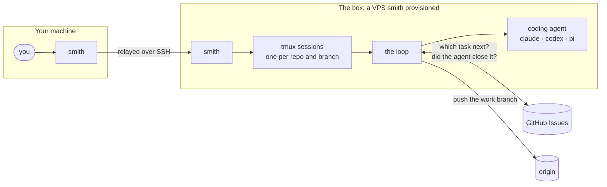
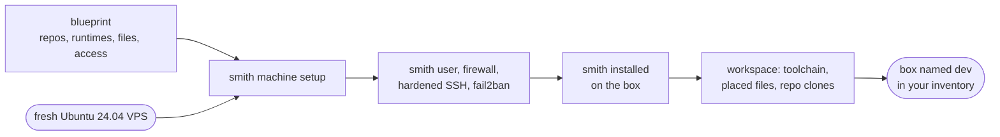
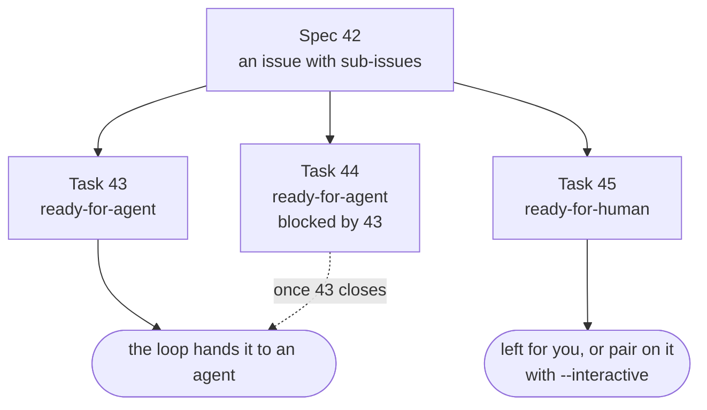
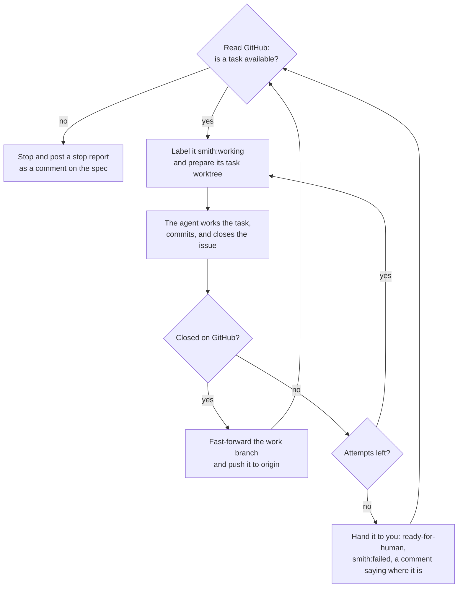
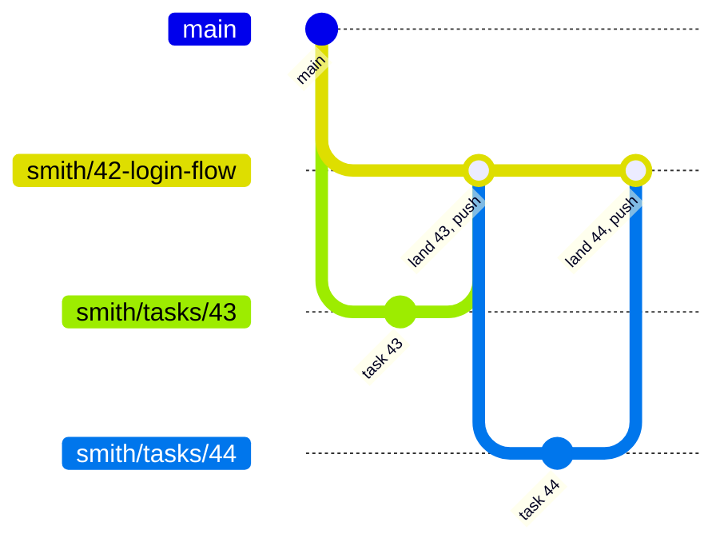
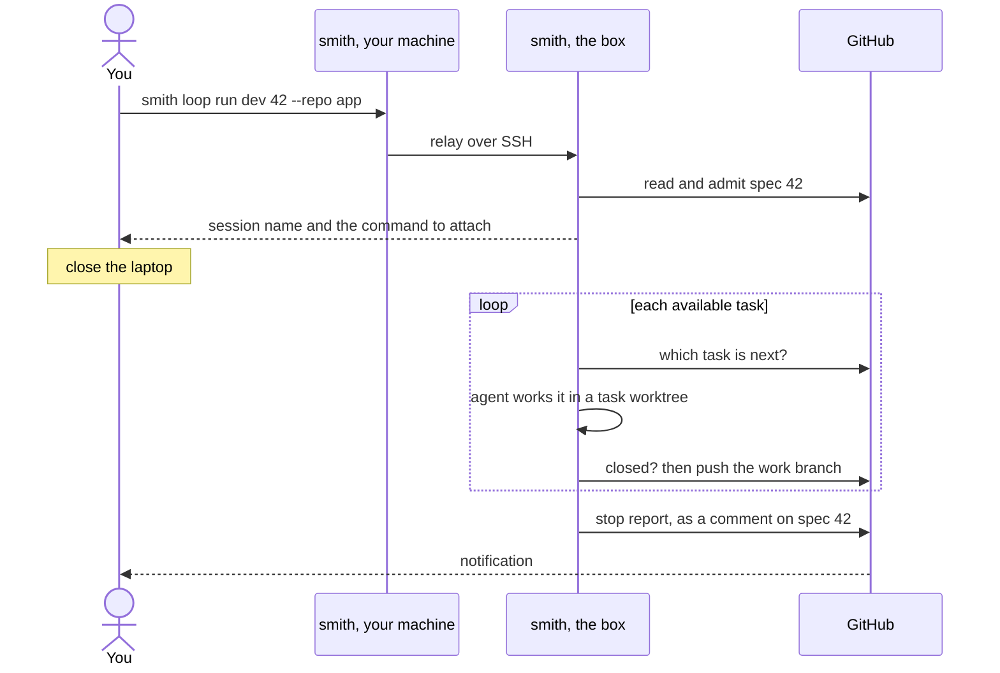

# smith

Smith turns a fresh VPS into a remote development machine and runs coding agents on it. You bring the box and write the issues; smith provisions the box, clones your repos, and runs the **loop**: you point it at a GitHub spec or task, and it hands the tasks to a coding agent one at a time, landing and pushing each closed one, until none is left for the agent. On a box, that run keeps going after you close your laptop.

**Project status: early development.** Smith is currently being built for personal use and experimentation. Interfaces, configuration and internal architecture may change without notice, and there is no `v0.x` compatibility promise — pin to an exact tag.



## How it works

Smith has two halves, and each exists for the other: **the box** is a place an agent can work unattended, and **the loop** is what puts agents to work there.

### The box

Smith is one static binary that lives in two places. On your machine it is a control surface. `machine setup` **installs the same binary onto the box**, and the verbs that do work there — the session verbs, `workspace converge` and `loop run <box>` — run there; your local smith relays them over SSH and streams the box's output back.



Three things make a box a smith box:

- A **blueprint**: one YAML file declaring what kind of box this is, with its repos, runtimes, placed files and access mode.
- The **box inventory**: a local name → address book, so you type `dev` instead of an address that changed when the box was hardened.
- **Sessions**: one `tmux` session plus one git worktree of one repo on one branch, the unit of parallel work on a box. A human drives some sessions; the loop drives others.

### The loop

You plan the work as GitHub issues: a **spec** whose sub-issues are its **tasks**, each labelled for who should do it. The loop reads that plan, not the agent: it chooses each task, hands exactly that task to the agent, and checks GitHub afterwards to see whether the agent closed it.



Each pass of the loop works one task:



An agent that fails on every attempt, such as with a dead credential, stops the run as `agent broken` instead of handing you the rest of the spec.

**A run has an end.** You start each run on one issue, and it stops when nothing is left for the agent. Given a spec, it works the spec's tasks in order. Given a task, it works only that task: a child task runs on its parent spec's work branch, with no sibling worked, and a standalone task gets a work branch of its own. smith doesn't watch GitHub for new work, so a task filed after the run stops waits for the next `loop run`, which adopts the same work branch and works only what is still open.

**It runs where smith runs.** `smith loop run 42` in a checkout on your own machine works the same way as on a box, in task worktrees of its own, never in your checkout. Any machine with a checkout, an authenticated `gh` and the agent's CLI will do, a container included. A box adds what your laptop can't: a run that outlives your connection.

No agent ever works in your checkout or pushes. Each task gets its own worktree and task branch, cut from the spec's **work branch**; when the task closes, the loop fast-forwards the work branch onto it and pushes, so closed work never exists on one machine only:



Mermaid draws each landing as a merge, but it is a fast-forward: the work branch ends up a straight line of task commits. Task branches are never pushed; open a PR from the work branch when the spec is done.

### The two together

On a box, the loop runs in a loop-driven session that outlives your SSH connection. You start it from your machine and walk away; when the loop stops, the session ends, and GitHub tells you how it went.



## Quick start

### 1. Install smith

macOS Apple silicon shown — [other platforms and checksum verification](docs/install.md):

```sh
curl -L https://github.com/byranZA/smith/releases/download/v0.1.1/smith_0.1.1_darwin_arm64.tar.gz | tar xz
sudo mv smith /usr/local/bin/
smith version
```

> Fetch with `curl`, not your browser: smith is unsigned, and a browser's quarantine flag makes macOS refuse to run it. See [Gatekeeper](docs/install.md#gatekeeper-macos).

### 2. Describe the box

Scaffold the config home — `~/.smith/`, with a starter `preferences.yaml` and a starter blueprint `personal` — then fill in the repos the box should clone, and check it:

```sh
smith init
smith blueprint check personal
```

For the loop, the box also needs to clone your repo and reach GitHub: see [a box that can clone and run the loop](docs/blueprints.md#a-box-that-can-clone-and-run-the-loop).

### 3. Provision it

Point smith at a fresh Ubuntu 24.04 box you can already reach over SSH as root or a passwordless-sudo user:

```sh
smith machine setup root@203.0.113.10 --name dev --blueprint personal
```

Smith creates a `smith` user with your SSH key, enables a default-deny firewall, hardens SSH, turns on fail2ban and unattended upgrades, installs smith on the box, converges the workspace, and writes down the address it just proved. From then on you use the name:

```sh
smith machine status dev                               # drift report; changes nothing
smith session start dev --repo app --branch spike      # a session of your own
```

To reach the box over a tailnet instead of the public internet, add `--access tailscale` — that path needs two entries in your tailnet ACL policy first. [Provisioning a box](docs/provisioning.md) covers both modes end to end.

### 4. Get the repo ready for the loop

In a checkout of the repo, write the repo file and commit it:

```sh
smith repo init --agent claude --model opus
git add .smith/repo.yaml && git commit -m "chore: add the smith repo file"
```

Then plan on GitHub: a spec issue with sub-issues for its tasks, each labelled `ready-for-agent` or `ready-for-human`. Check what the loop would do, without running anything:

```sh
smith loop list 42
```

### 5. Run the loop on the box

```sh
smith loop run dev 42 --repo app
smith session attach dev app-smith-42-login-flow    # watch, read-only
smith session list dev                              # each session's state and outcome
```

On a new repo or prompt, try one task with you watching first: `smith loop run --interactive 42` in a checkout, on your machine or in a session on the box.

## What smith does

### On the box

**Provisioning.** `machine setup` hardens a fresh box and is safe to re-run — every step checks before it changes anything. It works over public SSH or over Tailscale, and only closes public SSH once it has proved the tailnet route works, so a half-ready ACL never locks you out.
→ [docs/provisioning.md](docs/provisioning.md)

**Blueprints.** A blueprint (`~/.smith/blueprints/`) declares what kind of box smith builds; preferences (`~/.smith/preferences.yaml`) hold what belongs to you across every box. Both are optional — every field has a default, and `access` also has a flag, resolved **flag → blueprint → preference → default**, and every resolved field reaches the box. `smith blueprint check` validates them offline and prints the resolved configuration with the source of each value. `smith init` writes commented starters for both.
→ [docs/blueprints.md](docs/blueprints.md), a worked [blueprint](docs/examples/blueprints/acme.yaml) and [preferences](docs/examples/preferences.yaml), and [a box that can clone and run the loop](docs/blueprints.md#a-box-that-can-clone-and-run-the-loop)

**Making the box too.** Describe your provider's own CLI as data in a `provider` block and `smith machine create dev --blueprint acme` creates the box and waits until SSH answers, then prints the `smith machine setup` line that provisions it. Optional — without it you bring the box yourself.
→ [docs/providers.md](docs/providers.md)

**Boxes by name.** A successful setup registers the address it proved in `~/.smith/cache/boxes.json`; `machine list`, `add` and `forget` manage it. In every verb, **the `@` decides**: a value containing `@` is an SSH target used as written, a value without one is looked up in the inventory and, on a miss, handed to `ssh` — so an `ssh_config` alias or a MagicDNS name works with no smith configuration at all.
→ [docs/inventory.md](docs/inventory.md)

**The workspace.** Setup's last stage converges the box to the workspace its blueprint declares — placements, packages, the pinned toolchain, then a bare clone of every declared repo. It is a verb of its own, so you can re-converge without re-running the pipeline, and it never deletes: a step it cannot converge is reported and what the box already holds stays put.
→ [docs/workspace.md](docs/workspace.md)

**Sessions.** Five verbs — `start`, `attach`, `list`, `stop`, `rm` — over sessions named `<repo>-<branch>`. `start` is ensure-running, `attach` is read-only to a loop-driven session unless you ask for `--interact`, and `list` is the work-state readout you check before destroying a box by hand:

```text
NAME             STATE    DIRTY  UNPUSHED  DRIVER  OUTCOME
smith-main       live     -      0         human   -
smith-spec-42    stopped  dirty  3         loop    waiting on human

2 sessions · 1 dirty · 1 with unpushed commits
```

Attaching adds no listener, no port, no tunnel and no new credential — it is `tmux attach` through the SSH door setup already built.
→ [docs/sessions.md](docs/sessions.md)

**smith on the box.** Local and on-box smith must be the same version: every relayed command declares the version it was built by, and on-box smith refuses a mismatch rather than silently misparsing a renamed flag. `smith machine upgrade dev` converges the box to *your* version — including backwards. `smith update` updates your own smith to the latest release, then offers to converge every box to it.
→ [docs/on-box.md](docs/on-box.md)

### The loop

**Choosing tasks.** `smith loop run <issue>` works a spec's tasks, or a single task, one task per agent run. It reads GitHub Issues through your own authenticated `gh` before every choice, so a task filed or unblocked mid-run is seen. A task is available when it is open, labelled for the agent, and every blocker is closed. `smith loop list <issue>` shows the settings a run would use, the next task and what remains.
→ [docs/loop.md](docs/loop.md#what-the-loop-reads-from-github)

**Branches and pushing.** Each task is worked in its own worktree and lands on the spec's or task's work branch (`smith/<n>-<slug>`), which is pushed after each closed task. A later run adopts the same branch and works only the tasks still open. The worktree is prepared before every attempt: the toolchain the repo's mise config pins, then the repo's prepare command.
→ [docs/loop.md](docs/loop.md#the-work-branch)

**Stopping well.** Two limits bound an unattended run: attempts per task and agent runs per loop. Every run ends with an outcome — `complete`, `waiting on human`, `attempts exhausted`, `cap reached`, `agent broken`, `stopped` or `failed` — posted as a comment on the issue and shown in `smith session list`. While a task is being worked it carries the `smith:working` label, so GitHub shows what the loop is doing.
→ [docs/loop.md](docs/loop.md#smith-loop-run)

**On a box.** `smith loop run <box> <issue> --repo <name>` runs it on a box, in a loop-driven session that outlives your connection, after a preflight that refuses in your terminal what the session would refuse. `smith session attach` watches it read-only. `--interactive` runs one task with the agent attached to your terminal, and pairs you with an agent on a task meant for a human.
→ [docs/loop.md](docs/loop.md#on-a-box---repo)

**The repo file.** `.smith/repo.yaml` holds the loop settings the repo shares: named **presets** (an agent — `claude`, `codex` or `pi` — with a model and effort, chosen whole) with the `work` role pointed at one, plus its push setting, prepare command and triage labels. A task can run on a preset of its own with a `preset:<name>` label. The loop prompt is deliberately generic and sends the agent to the repo's own `AGENTS.md`; eject it to `.smith/prompt.md` to change it.
→ [docs/loop.md](docs/loop.md#the-repo-file)

> **smith provisions no service's credentials.** It places files and exports environment variables. (The loop reads GitHub Issues through your own authenticated `gh`, and holds no credential of its own.) A blueprint declaring `GITHUB_TOKEN` beside `https://` clone URLs **will not authenticate** — git needs a credential helper for that, and smith will not notice. Place the helper's config yourself, or clone over SSH and place the key: [a box that can clone and run the loop](docs/blueprints.md#a-box-that-can-clone-and-run-the-loop).

> **An unattended run asks you nothing.** No one is there to approve anything, and `codex --yolo` bypasses both its approvals and its sandbox. Run the unattended loop where an agent with your shell is acceptable: a box, a container, or a machine you would trust it on.

## Documentation

[docs/](docs/README.md) is the full index. The decision records behind the behaviour above are in [docs/adr/](docs/adr/).

## Contributing

Smith is **not accepting outside pull requests yet** — it is early enough that the design still moves faster than a review could keep up with.

[CONTRIBUTING.md](CONTRIBUTING.md) has the detail. Fresh-machine setup and the quality gate for anyone working in the repository are in [docs/development.md](docs/development.md).

## License

[Apache 2.0](LICENSE).
